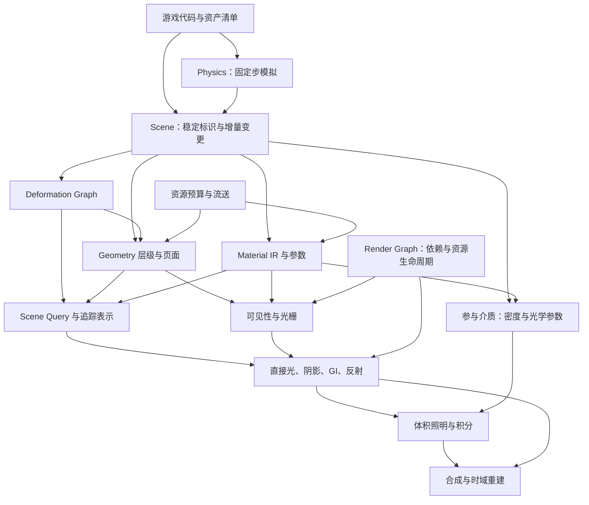

# 架构设计：统一的场景与渲染合约

状态：设计基线，2026-10-14。本文描述目标架构，不表示全部能力已经实现。阶段安排见 [roadmap.md](roadmap.md)，验收见 [benchmarks.md](benchmarks.md)。

## 目标与边界

Real Engine 是面向 AI 编写游戏代码的浏览器 WebGPU 通用引擎。核心提供可组合的通用技术模块、明确的数据接口、运行成本和诊断；游戏代码负责玩法、内容组合及项目特有的小规模逻辑。代码和资产构建产物是事实来源，不建设可视化编辑器、节点编辑器或专用关卡工作流。

几何、光照、材质与形变从第一阶段共用合约。项目所说的“完全互相兼容”，指所有已声明支持的组合，在主视图、阴影、反射、GI、深度和运动重建中有一致语义；不允许某个系统静默忽略对象或退回错误材质。兼容不意味着所有材质都走同一算法，也不意味着任意用户代码、无界层数或无限动态场景具有固定开销。

原生浏览器 WebGPU 是发布路径。功能需要根据适配器能力分级；实验浏览器特性仅作为优化路径。代码优先减少工具交互成本，不会消除编译、缓存、资源调度和多路径一致性的研发成本。

## 模块边界

| 模块 | 输入与输出合约 | 不承担的职责 |
| --- | --- | --- |
| Scene | 实体、实例、资源句柄；帧快照与增量变更 | 玩法实体分类、关卡规则 |
| Geometry | 原始/构建资产、簇层级、误差、页面、边界 | 自行决定对象是否参与离屏光照 |
| Deformation | 算子图、状态、当前/前帧几何与边界 | 为角色、树木分别复制基础执行管线 |
| Material | 类型化 IR、参数、覆盖与光学行为、依赖声明 | 包含任意不可追踪副作用的游戏代码 |
| Scene Query | 射线、过滤与质量要求；命中、材质位置、版本 | 把相机可见列表当完整世界 |
| Lighting | 场景查询、材质与光源；直接/间接光与历史 | 在不通知的情况下忽略动态对象 |
| Participating Media | 世界空间密度/光学参数、灯光与查询；散射辐亮度和透射率 | 烟火流体模拟、天气玩法或用雾隐藏几何错误 |
| Render Graph | pass 读写、资源格式/用途、生命周期 | 隐式全局 GPU 状态 |
| Resources | 加载、解码、上传、驻留、淘汰及预算 | 无上限缓存 |
| Physics | 刚体、碰撞体、约束、固定步输入/输出 | 强制碰撞表示等于渲染微三角形 |

## 场景身份、版本与变更

运行时句柄采用索引与 generation，防止回收后的旧引用误指新对象；持久资产另有稳定 asset ID 与内容哈希。实体身份与顶点索引分离。几何、拓扑、形变、材质参数、覆盖、纹理驻留各自有版本，避免任意变化都引起全场景重建。

游戏和物理在明确边界提交变更，渲染消费不可变帧快照。变更集声明影响：变换、形变、拓扑、材质数值、材质程序、透明覆盖、发光、资源页面。依赖系统据此更新包围盒、加速结构、阴影、光照缓存和时域历史。对象离开相机画面不等于离开场景，离屏反射和遮挡仍能查询它。

资源与代理允许延迟更新，但必须返回版本、更新状态和允许的最大陈旧度。首版不得以无限保留旧缓存掩盖更新成本。

## 统一形变图

形变按算子和数据依赖表达，例如刚体变换、蒙皮、Morph、曲线变形、程序位移、约束与模拟结果混合。角色、植被、机械和可变形道具是这些算子的组合，不是核心内互不兼容的对象类别。

每个算子声明输入输出、执行频率、坐标空间、是否保持拓扑、所需邻接信息、位移/边界约束以及前帧求值方式。编译器进行常量折叠、融合、共享与调度；同一帧被深度、阴影、材质和查询重复使用的蒙皮/Morph 结果应共享缓存。缓存键包括资产、实例状态、算子图版本和帧；不能只按网格资产缓存而串用不同动画。

光栅几何和追踪代理可以使用不同细节级别，但必须来自同一形变状态，并公开几何误差与更新时间。优先建立可验证的共享表示，再优化代理。拓扑变化是专门事件：重建必要结构、更新 surface ID 映射并拒绝失效历史，不能作为普通位置更新处理。

屏幕空间照明的接收面必须区分“实际可见光栅表面”和“查询代理命中”。可选光栅接收面预渲染复用最终 PBR 的几何切分、材质导数和覆盖规则，在 Hi-Z 补回之后再交给 Final Gather；身份、前帧位置与几何/材质法线显式传递。接收面附件、resize 重叠分配和额外 pass 耗时单独计账。后续光路使用代理时，其误差和自相交问题仍需独立验收，不能因接收面一致而隐去。

Final Gather 的原始时域估计与空间滤波输出分别保存。原始历史携带亮度均值的方差估计，移动重投影合并各历史内部的方差及均值之间的差异；身份或版本失效时一起清空。空间滤波同时使用表面兼容性与亮度统计，逐步启用新历史的可信度，避免把第一次零采样当作可靠黑色。统计存储计入原有预算；有限历史、相关采样和移动重投影下的方差只是滤波依据，不是正式置信区间。光照边界、均匀场能量、噪声抑制及运动历史必须分别验收。

## 材质编译与光学语义

材质采用代码构建的类型化 DSL/IR，初期提供固定 PBR、Unlit、Opaque/Masked 与基础透明模型，逐步加入皮肤、布料、发丝、透射和有限层叠。参数计算与 BSDF 分离，光学接口包含求值、采样和概率密度，或明确标记对应路径的近似算法。

同一 IR 分阶段产生形变、覆盖、表面参数、阴影/深度、速度、GI 捕获和命中着色入口。编译期值、每材质值、每实例值与每像素值分别处理；数值和纹理参数改变不应重新创建 pipeline。静态特性改变可以生成新变体，但变体必须可枚举、缓存和预热。

Mask 在所有路径共用覆盖定义；透射不能用 alpha 混合冒充物理透射。视角依赖的屏幕效果与世界空间材质明确区分。皮肤空间散射、发丝透射等可使用专用 pass，其场景身份、材质依赖和照明语义保持一致。

自定义 WGSL 扩展需要声明资源、依赖、合法求值上下文、边界及副作用。不能验证的扩展进入显式特殊路径或构建报错；不能同时承诺任意代码自由和所有自动优化。诊断必须定位到源代码，说明哪种组合不可用、为什么、采用什么公开降级。

## 光照、反射与参与介质的统一合约

以下描述阶段 2 的目标，当前能力以 [implementation.md](implementation.md) 为准。各光路读取同一场景身份、材质、形变和遮挡状态，离屏物体与光源仍参与世界空间查询；共享状态有明确版本及历史失效边界。

| 光路 | 共享输入与更新 | 输出和限制 |
| --- | --- | --- |
| 直接光与阴影 | 灯光、表面材质、共享形变和 Mask 覆盖；主视图与其他光路复用遮挡状态，不重复求值角色或植被动画 | 有界的直接照明与阴影；灯光、覆盖和形变改变须更新依赖 |
| GI | 世界查询、空间辐射与低阶方向信息；材质、灯光、形变和几何页面变化驱动缓存更新 | 遮挡感知的低频间接光；不能把某表面的最终颜色或法线相关 irradiance 直接当作空气中的光 |
| 反射 | 离屏动态几何、材质 BSDF 和共享查询；屏幕追踪仅补细节 | 粗糙及受控光滑反射；按反射起点和方向求介质光路，不复用相机累计雾，超范围给出能力诊断 |
| 参与介质 | 米制世界密度、光学系数、灯光、阴影与低频 GI；局部体积由游戏代码创建和变更 | 路径透射率与散射辐亮度；初版单次散射，可用各向异性低阶近似，公开多重散射及双向反馈缺口；不把密度伪装为表面 alpha |

介质输入有有限边界或显式全局高度分布；输出非负的每米消光 `sigma_t`、0–1 散射反照率 `albedo`、相函数参数和非负发光项，`sigma_s = albedo * sigma_t`。零消光使用稳定积分极限，重叠体积按系数相加并有界混合相函数，不能直接叠加雾颜色。程序噪声和纹理密度须声明边界、采样成本、时间依赖及历史版本；核心不包含雾编辑器。

主视图采用有界的低分辨率视锥三维网格，依次注入介质、求直接/间接光与遮挡、时序处理、沿深度积分和合成。网格只是视图缓存，世界介质定义不随相机改变；格式、分辨率、深度范围、灯数、体积重叠数和采样数都有预算。Compute 与纹理路径按 WebGPU 能力检查，不依赖硬件光追或无界绑定。这一分解参考 [Wronski 的 SIGGRAPH 2014 方案](https://bartwronski.com/wp-content/uploads/2014/08/bwronski_volumetric_fog_siggraph2014.pdf)，具体布局由测量决定。

表面、反射和介质在线性 HDR 中按各自光路合成：`L_out = L_fog + T * L_surface`，之后才曝光与色调映射。不透明深度截断积分，天空使用明确的雾视距；透明/折射按分段光路处理，避免重复合成。反射采用有界世界空间介质采样或受支持的反射视图缓存，报告范围、采样数与误差。

介质历史按三维位置重投影，不仅依赖表面运动向量；相机切换、分辨率/网格改变、体积增删/移动、密度突变、灯光和遮挡变化驱动失效或降权。移动灯光与短闪光受响应上限约束。Render Graph 显式声明密度、照明、历史、积分及合成依赖，资源账本和 GPU 时间戳分别记录；主视锥剔除不得排除反射中的介质或离屏投影物。

## 调度、资源与物理

Render Graph 显式记录读写和资源使用方式，验证依赖、生命周期及跨 pass 一致性；优先复用临时资源并控制峰值。应用资源账本分别统计几何、纹理、形变、追踪结构和历史缓存，不把账本说成驱动真实显存驻留量。

资产构建、解码和网络加载离开主线程；GPU 上传与后台构建有每帧预算。几何缺页保留可绘制祖先，纹理缺页保留有效低 mip；淘汰不得破坏仍在使用的 GPU 资源。

物理通过可替换适配器接入，阶段 1 采用 Rapier，Jolt 保留为后续基准候选；采用固定时间步、明确的插值和事件边界。碰撞几何可简化，但来源、单位、变换与版本可追溯，不能随相机 Nanite 式 LOD 任意变化。角色控制器、车辆规则等由游戏侧组合，核心只保留通用查询、刚体、约束和运动同步能力。

## AI-native 的工程接口

核心输出结构化编译错误、资源预算、能力矩阵、pass 耗时与场景快照。配置和资产构建可重复，接口版本可迁移，示例是可执行代码。优化必须由基准证明；可移植性、验证层、设备丢失处理和交叉场景回归从第一阶段持续进行。
